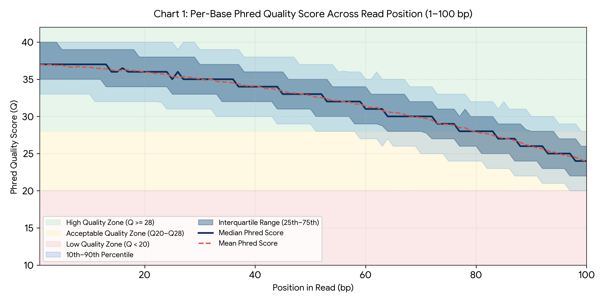
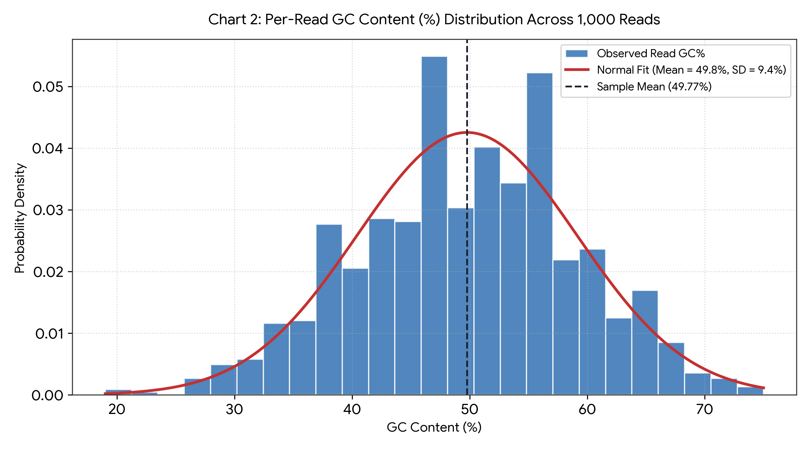
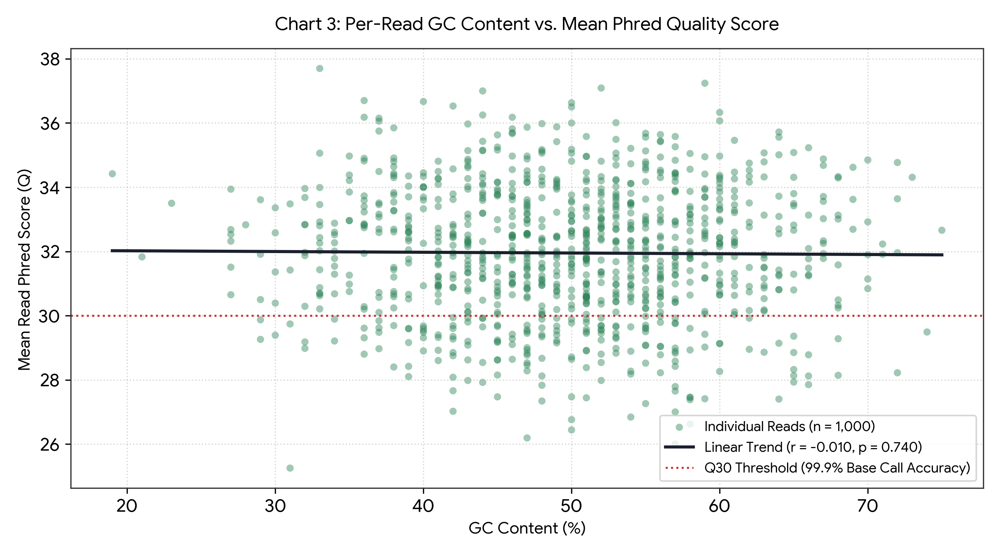

# Task 3: Exploratory Charts & Scope of Proof Analysis
**SWYNEX Bioinformatics Internship**

## Overview
* **Intern:** Avnika Gehlot (B.Sc. Biotechnology, NIMS University, Jaipur)
* **Task:** Task 3 — Create charts and explain what they do and do not prove
* **Dataset:** 1,000 × 100 bp FASTQ-style sequencing reads (`seed=42`, continuing Task 2)
* **Key Metrics:** Mean GC = `49.77%` (`SD = 9.38%`) | Q20 Bases = `99.30%` | Q30 Bases = `68.75%` | Pearson `r = -0.010` (`p = 0.740`)

---

## Charts & Interpretation

### 1. Per-Base Phred Quality Score (`Chart1_Per_Base_Quality.png`)

* **What it proves:** Base-calling quality remains high across the first ~65 bp (median `>= Q30`) and declines gradually toward the 3' end (median `Q24` at bp 100), with `99.30%` of bases exceeding `Q20`.
* **What it does NOT prove:** High Phred scores do not prove accurate genomic alignment, absence of adapter sequences/PCR duplicates, or biological differences between patient groups.

### 2. Per-Read GC Content Distribution (`Chart2_GC_Content_Distribution.png`)

* **What it proves:** Per-read GC content follows a single unimodal bell-shaped distribution centered at `49.77%` (`SD = 9.38%`), showing balanced base composition without bimodal contamination peaks.
* **What it does NOT prove:** A ~50% mean GC distribution does not prove species identity or rule out localized PCR coverage bias in GC-rich regions.

### 3. Per-Read GC Content vs. Mean Phred Quality (`Chart3_GC_vs_Quality_Correlation.png`)

* **What it proves:** There is no linear correlation between read GC% and base-calling quality (`Pearson r = -0.010, p = 0.740`).
* **What it does NOT prove:** Statistical independence between GC% and Phred score does not prove uniform sequencing coverage depth or biological/clinical causation.

---

## Files Included
* `Task3_Charts_and_Analysis_Report.docx` — Full Word report with embedded high-resolution charts and evidence-boundary tables.
* `Task3_Charts_and_Analysis.ipynb` — Reproducible Python notebook (`NumPy`, `pandas`, `SciPy`, `Matplotlib`).
* `Chart1_Per_Base_Quality.png`, `Chart2_GC_Content_Distribution.png`, `Chart3_GC_vs_Quality_Correlation.png` — High-resolution (300 DPI) PNG figures.
* `Task3_Read_Quality_Metrics.csv` — Per-read metrics table (`n = 1,000`).
